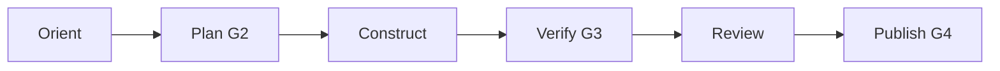

# Thunai: AI-First Project Template

[](https://github.com/MettaSurendhar/thunai/actions/workflows/ci.yml)
[](./LICENSE)
[](./CHANGELOG.md)

A drop-in setup that makes AI coding assistants work on issues the way your team does: one coordinator agent (**Thunai**, Tamil for "companion"), five bounded specialists, a library of skills, binding rules, persistent memory and git guardrails. It generates native configuration for **VS Code Copilot**, **Claude Code** and **OpenCode** from one source.



## Why

AI assistants are fast but unbounded: they widen scope, skip tests, claim results they did not run, and push to `main`. Thunai gives them a shared operating model instead of ad-hoc prompts: work is tied to one issue, plans need your approval, claims need evidence, and git writes are gated. You write the rules once and every supported tool follows them.

| Tool | Support |
|---|---|
| VS Code with GitHub Copilot | Agents, instructions, prompts, skills, terminal approval settings |
| Claude Code | Agents, commands, skills, `CLAUDE.md`, and a `PreToolUse` git guard hook |
| OpenCode | Agents, commands, skills; bash permission patterns (see `.thunai/README.md`) |

Requirements: Python 3.10+ and git. No third-party Python packages.

## Quick start

```text
python init.py                       # prompts for name, teams, packs
python init.py --non-interactive --name "Acme Shop" --packs web-nextjs,api-fastapi
```

Already have a repository? Run one command from a clone of this template ([details](./.thunai/docs/using-the-template.md#adopt-thunai-in-an-existing-repo)):

```text
python adopt.py ../my-repo --dry-run   # preview
python adopt.py ../my-repo             # install, merging into existing files
```

Then fill `commands.*` and `docs.*` in `.thunai/config/project.config.json`, edit `.thunai/memory/who-owns-what.md`, open your AI tool and run `/orient`. Prefer doing it by hand? Follow [TEMPLATE.md](./TEMPLATE.md).

## What is where
| Path | Purpose | Edit? |
|---|---|---|
| `AGENTS.md` | Always-on persona, gates, routing | yes |
| `skills/` | Canonical skills (core: workflow, review, security, TDD, debugging) | yes |
| `packs/` | Optional stack skill packs ([packs/README.md](./packs/README.md)) | yes |
| `.thunai/src/` | Agents, rules, commands (the source of truth) | yes |
| `.thunai/config/project.config.json` | Project, teams, packs, branch rules, commands, docs | yes |
| `.thunai/memory/` | Persistent corrections and ownership | yes |
| `.thunai/hooks/` | Git guard (blocks unsafe git/gh writes) | rarely |
| `.github/`, `.claude/`, `.opencode/`, `CLAUDE.md` | Generated by `python .thunai/sync.py` | **no** |

After editing any source, run `python .thunai/sync.py` (`--check` in CI). Details: [.thunai/README.md](./.thunai/README.md).

## Core ideas
- **Issue-scoped:** every task maps to one issue and an explicit list of paths; `outOfScope` in the config is off limits.
- **Gates:** plan approval, evidence, and each git/GitHub write need the user's approval.
- **Evidence-first:** no claim of a passing check unless it ran.
- **Stack-agnostic core, opt-in packs:** add `web-nextjs`, `api-fastapi` or your own.
- **Teams optional:** one team by default; list several in `teams` and branch names, docs lookup and scope follow.

## Adapting
- Add a rule: write `.thunai/src/rules/<name>.md`, sync.
- Add a skill: `skills/<name>/SKILL.md` (frontmatter `name` = folder name, trigger words in `description`), sync.
- Add a stack: create a pack.
- Tune behavior: add corrections to `.thunai/memory/operating-rules.md`.

## Documentation
- [Using the template](./.thunai/docs/using-the-template.md): bootstrap, and what to delete from your new project
- [Agent kit reference](./.thunai/README.md): configuration, per-tool start-up, guardrails
- [Stack packs](./packs/README.md) and [adding a pack](./.thunai/docs/adding-a-pack.md)
- [Manual setup checklist](./TEMPLATE.md)

## Contributing
Contributions are welcome: see [CONTRIBUTING.md](./CONTRIBUTING.md) and the [Code of Conduct](./CODE_OF_CONDUCT.md). Report vulnerabilities privately as described in [SECURITY.md](./SECURITY.md). Changes are listed in [CHANGELOG.md](./CHANGELOG.md).

## License
[MIT](./LICENSE). Some skills are copied or adapted from other MIT-licensed projects; see [THIRD_PARTY.md](./THIRD_PARTY.md).
